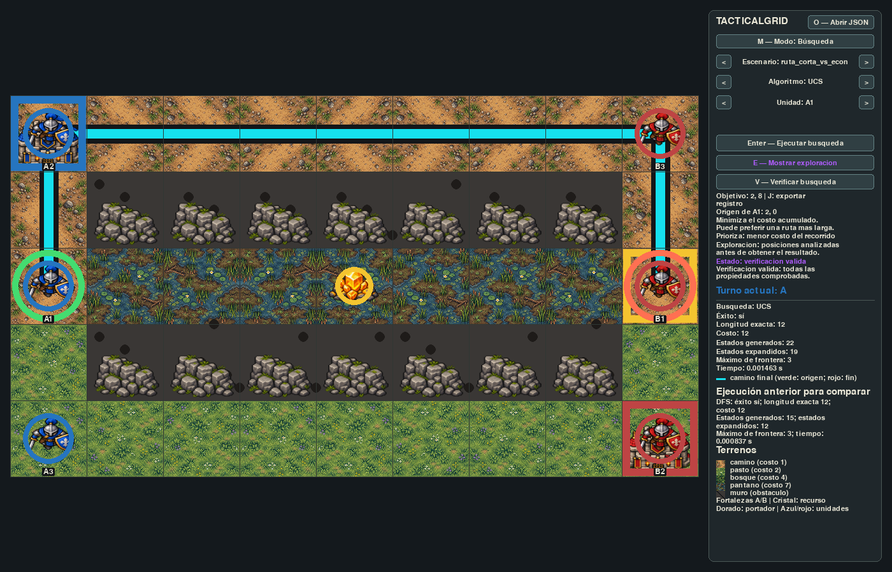

# TacticalGrid

**Juego táctico 2D por turnos para experimentar con búsqueda y toma de decisiones.**


Dos bandos compiten en una cuadrícula por tomar un recurso y llevarlo a su base. TacticalGrid no es un videojuego
comercial: es un entorno para observar cómo decide un sistema inteligente cuando pasa de encontrar una ruta a
optimizar su costo, usar conocimiento heurístico y, finalmente, enfrentarse a un adversario que también razona.



- **Siete algoritmos** sobre el mismo modelo: BFS, DFS, UCS, A* con dos heurísticas, Beam Search, Minimax y Minimax
  con poda alfa-beta.
- **Escenarios externos en JSON**, validados por completo antes de usarse. Ningún mapa, posición ni costo está
  escrito en el código.
- **Tres modos de prueba:** `busqueda`, `adversarial` y `partida`, desde la consola o el propio escenario.
- **Respuestas verificables y reproducibles:** el verificador comprueba cada resultado con las reglas del juego, y
  cada ejecución puede exportarse en JSON con el comando que la repite.

Proyecto de Sistemas Inteligentes I, Ingeniería de Sistemas y Computación, Universidad de Caldas.

## Ejecución rápida

Requisitos: **Python 3.12 o 3.13** (Pygame aún no funciona con 3.14) y **Git**.

### Windows (PowerShell)

```powershell
git clone https://github.com/diego-juan3112/tactical-grid.git
cd tactical-grid
py -3.13 -m venv .venv
.\.venv\Scripts\Activate.ps1
python -m pip install -e ".[desarrollo]"
python main.py
```

### Linux

```bash
git clone https://github.com/diego-juan3112/tactical-grid.git
cd tactical-grid
python3.12 -m venv .venv
source .venv/bin/activate
python -m pip install -e '.[desarrollo]'
python main.py
```

`python main.py` abre la interfaz gráfica. Para usar la consola, agrega `--consola` y la ruta de un escenario:

```bash
python main.py --consola escenarios/ruta_corta_vs_economica.json --algoritmo ambos
```

> **Si algo falla:** en Windows, si PowerShell no permite activar el entorno, ejecuta una vez
> `Set-ExecutionPolicy -Scope CurrentUser RemoteSigned`. En Ubuntu, si `venv` no está disponible, instálalo con
> `sudo apt install python3.12-venv`. Con solo Python 3.12 en Windows, usa `py -3.12`.

Cada vez que abras una consola nueva, activa el entorno antes de ejecutar la aplicación.

## Uso

El [manual de usuario](docs/entregables/manual-de-usuario.docx) explica cada paso con capturas. Aquí está lo
esencial.

### Interfaz gráfica

```bash
python main.py
python main.py --gui escenarios/ruta_corta_vs_economica.json --algoritmo ucs --unidad A1 --objetivo 2 8
```

En el panel se elige el escenario, el algoritmo (`bfs`, `dfs`, `ucs`, `astar` o `beam`), la unidad y el ancho `k` de
Beam Search. Un clic en el tablero elige el objetivo. `Enter` ejecuta la búsqueda y `E` muestra u oculta las celdas
exploradas.

Para abrir un escenario propio, como el del profesor, usa el botón **O — Abrir JSON** (o la tecla `O`), o arrastra el
archivo `.json` sobre la ventana. Si el archivo tiene errores, el panel los explica y el escenario actual no cambia.

### Consola

La consola ejecuta el modo que declara el campo `prueba` del escenario, o el que se indique con `--modo` y
`--algoritmo`. Las opciones de la consola tienen prioridad sobre el JSON.

```bash
# Búsqueda: navegación de una unidad hasta un objetivo
python main.py --consola escenarios/campo_20x20.json
python main.py --consola escenarios/campo_20x20.json --algoritmo beam --k 1 2 4 8

# Decisión adversarial: la mejor jugada del bando en turno
python main.py --consola escenarios/decision_adversarial.json
python main.py --consola escenarios/recurso_en_transporte.json --algoritmo minimax_alfa_beta --profundidad 3

# Partida completa: ambos bandos deciden con el mismo algoritmo
python main.py --consola escenarios/estado_compuesto_portador.json --modo partida
```

| Opción | Uso |
|---|---|
| `--modo` | `busqueda`, `adversarial` o `partida`. |
| `--algoritmo` | Búsqueda: `bfs`, `dfs`, `ucs`, `a_estrella`, `beam`, `ambos` (BFS y UCS) o `bfs_dfs`. Adversarial: `minimax`, `alfa_beta` o `minimax_alfa_beta`. |
| `--unidad`, `--objetivo FILA COLUMNA` | Unidad y destino de una búsqueda. |
| `--k` | Ancho de Beam Search; admite varios valores. |
| `--profundidad`, `--orden` | Profundidad de Minimax y orden de acciones (`generacion`, `inverso` o `tactico`). |
| `--turnos` | Límite de jugadas del modo partida (50 por defecto). |
| `--verificar` | Comprueba la respuesta con las reglas del juego. |
| `--json`, `--exportar ARCHIVO` | Muestra o guarda el resultado en JSON, con el comando que lo reproduce. |

`python main.py --consola --help` lista todas las opciones.

### Escenarios externos

Cualquier archivo con el formato JSON común del enunciado se carga sin cambiar el código:

```bash
python main.py --consola ruta/al/escenario.json --verificar
```

Si el escenario tiene un error, la aplicación indica el campo, el elemento y el valor que lo causan, no aplica nada y
termina con código 1.

## Escenarios incluidos

| Archivo | Tamaño | Para qué sirve |
|---|---|---|
| `campo_20x20.json` | 20 × 20 | Mapa principal: lago de pantano, bosques y muros. La ruta más corta no es la más barata. |
| `arquitectura_basica.json` | 20 × 20 | Mapa abierto, todo camino. Sin `prueba`: indica `--unidad` y `--objetivo`. |
| `ejemplo_enunciado.json` | 4 × 4 | Ejemplo literal del enunciado. |
| `ruta_corta_vs_economica.json` | 5 × 9 | La ruta recta cruza pantano (8 movimientos, costo 50); rodear cuesta 12. |
| `obstaculo_rodeo.json` | 8 × 7 | Un muro en U obliga a rodear un objetivo cercano. |
| `recurso_en_transporte.json` | 6 × 8 | Partida con el recurso ya en manos de A2. |
| `estado_compuesto_libre.json` | 5 × 5 | Mismas casillas que el siguiente, con el recurso libre. |
| `estado_compuesto_portador.json` | 5 × 5 | Mismas casillas, pero A1 lleva el recurso. |
| `decision_adversarial.json` | 3 × 6 | Tomar el recurso parece bueno, pero el rival lo intercepta. |

Las propiedades de cada escenario se comprueban en `tests/escenario/test_escenarios_propios.py`.

## Pruebas

```bash
python -m pytest
```

La suite cubre escenario, juego, algoritmos, modos, interfaz (con el controlador de video *dummy*) y la convención de
documentación de métodos. Las cifras de los diez casos mínimos están fijadas en pruebas.

## Documentación

### Entregables

| Documento | Contenido |
|---|---|
| [Documento técnico](docs/entregables/documento-tecnico.docx) | Modelado del problema, representación de estados, reglas, costos, heurísticas, función de utilidad, metodología experimental, resultados, complejidad, limitaciones y uso de IA. |
| [Manual de usuario](docs/entregables/manual-de-usuario.docx) | Instalación en Windows y Linux, interfaz gráfica, modos de consola, escenarios externos, verificación y exportación de resultados, con capturas de cada paso. |

Ambos se editan directamente en Word y siguen el diseño editorial de [DESIGN.md](DESIGN.md).

### Detalle técnico

El documento técnico resume; estos archivos explican cada parte con su historia, sus decisiones y sus ejemplos
verificados.

| Archivo | Historias | Contenido |
|---|---|---|
| [01 · Arquitectura y modelo](docs/tecnico/01-arquitectura-y-modelo.md) | E0.3, E1.1–E1.3, E2.2, E2.3, E3.1, E3.2 | Capas, estado del juego, acciones y costo, reglas de borde, validación, escenarios propios, turnos y recurso. |
| [02 · Búsqueda](docs/tecnico/02-busqueda.md) | E4.1–E7.1 | Instrumentación común, BFS, DFS, UCS, A* con Manhattan y Beam Search. |
| [03 · Heurística HTO](docs/tecnico/03-heuristica-hto.md) | E6.2 | Segunda heurística: definición, admisibilidad, consistencia, costo y campaña experimental. |
| [04 · Decisión adversarial](docs/tecnico/04-decision-adversarial.md) | E8.1–E8.6 | Acciones tácticas, función de utilidad, Minimax, poda alfa-beta, métricas y orden de acciones. |
| [05 · Modos, verificación y registro](docs/tecnico/05-modos-verificacion-y-registro.md) | E10.1–E10.3 | Modos `busqueda`, `partida` y `adversarial`, verificador de soluciones y registro reproducible. |
| [06 · Interfaz](docs/tecnico/06-interfaz.md) | E9.1–E9.3 | Tablero, camino, capa de exploración y presentación gráfica. |

### Casos mínimos

Los diez casos que exige el enunciado, con su configuración, el resultado esperado y el obtenido. Las cifras están
fijadas en pruebas automatizadas.

| Casos | Archivo |
|---|---|
| 1. BFS frente a DFS · 2. Ruta corta frente a económica · 5. Beam Search | [casos-1-2-5-busqueda.md](docs/casos-minimos/casos-1-2-5-busqueda.md) |
| 3. Obstáculo y heurística · 4. Comparación de heurísticas | [casos-3-4-obstaculo-y-heuristicas.md](docs/casos-minimos/casos-3-4-obstaculo-y-heuristicas.md) |
| 6. Estado compuesto · 7. Decisión adversarial · 8. Minimax frente a alfa-beta · 9. Orden de acciones · 10. Profundidad | [casos-6-10-adversariales.md](docs/casos-minimos/casos-6-10-adversariales.md) |

### Otros recursos

- [Enunciado del proyecto](docs/enunciado/primer-proyecto.pdf).
- [Imágenes](docs/imagenes/): captura de la interfaz y evidencia del rediseño visual (`redisenio-visual/`).
- [AGENTS.md](AGENTS.md): reglas y convenciones del proyecto, incluida la documentación de métodos.
- [DESIGN.md](DESIGN.md): diseño editorial de los entregables en Word.

## Arquitectura

```text
JSON ──► escenario ──► juego ──► algoritmos ──► resultado
                         ▲            ▲
                         └── modos ───┘  ◄── consola / interfaz Pygame
```

| Capa | Responsabilidad |
|---|---|
| `escenario/` | Carga, valida y representa el JSON. |
| `juego/` | Estado, reglas, acciones, recurso, tácticas y el contrato `Problema`. |
| `algoritmos/` | Búsquedas, heurísticas, utilidad, Minimax, alfa-beta, métricas y verificador. |
| `modos/` | Modos de prueba y registro reproducible. |
| `interfaz/` | Visualización con Pygame. |
| `servidor/` | Punto ASGI aislado (`python -m uvicorn tacticalgrid.servidor.asgi:aplicacion`). |

Los algoritmos no importan Pygame ni leen archivos, y toman todos los costos del escenario cargado. El detalle está
en [arquitectura y modelo](docs/tecnico/01-arquitectura-y-modelo.md).

```text
tactical-grid/
├── main.py              # punto de entrada: interfaz gráfica o consola
├── src/tacticalgrid/    # código fuente, una carpeta por capa
├── tests/               # pruebas automatizadas
├── escenarios/          # escenarios JSON propios
├── scripts/             # experimento comparativo de heurísticas
└── docs/                # entregables, detalle técnico, casos mínimos, enunciado e imágenes
```

## Tecnologías

Python, Pygame para la interfaz, pytest para las pruebas, Uvicorn para el punto ASGI y JSON como formato de
escenarios.

## Equipo

- Juan Diego Henao Quintero ([@diego-juan3112](https://github.com/diego-juan3112))
- Ana Suárez ([@Aisc07](https://github.com/Aisc07))
- Santiago Silva ([@SilvaG35083](https://github.com/SilvaG35083))

## Uso de IA

El equipo usó IA generativa (Codex y Claude) como apoyo y lo declara en la documentación de cada método y en la
sección 17 del documento técnico, como exige el enunciado. Cada integrante responde por todo el código entregado.
